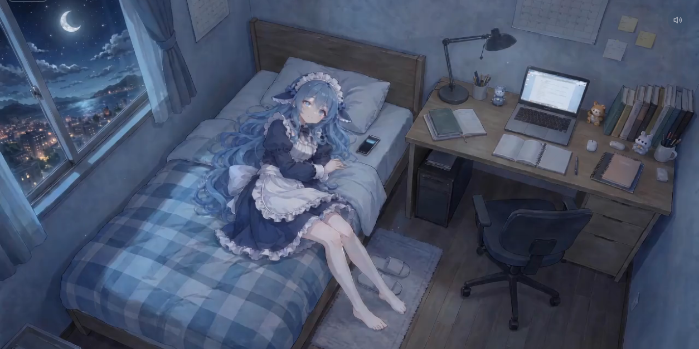

# 大肥鱼的小屋 · Fish House

> 主题画布驱动的视频壁纸，做成 Coopanion 的 World 扩展。
> 每个节点是一段视频，连线决定 Coopanion 收到消息、思考、干活时怎么演。
>
> 源码：https://github.com/AgSilveryin/cortico-world-fish-house

A canvas-driven video wallpaper World for [Coopanion](https://github.com/Pal-AI-Lab/Coopanion). Every canvas node is a clip; the edges decide which clip plays when a message arrives, while the model thinks, and while it works.

这是「大肥鱼的小屋」（AstrBot 插件，MIT，作者 jiuchai）的 Coopanion 适配版，沿用原项目的主题包格式、画布概念与壁纸页，运行时、触发方式和面板按 Cortico World API 6 重写。**不是原插件的完整移植**：AstrBot 的消息挂载、回复闸门和 Python 主题市场服务端没有搬过来，替代方式见下文「和原版的差别」。

## 它做什么

- **画布驱动**：主题是一套画布（节点 + 连线）。循环节点停在原地等消息；收到消息后沿出边走到「回消息」节点；模型思考、回话时停在那里；回合结束继续往下（通常是「放下手机」→ 回到休息）。
- **视频叠化**：两个视频层交叉淡化，音量也跟着交叉；循环视频播到首尾衔接点才切换，不打断动画。
- **底部气泡**：进入节点显示节点自带的提示词（最多 40 字，4 秒淡出），模型也可以用 fishhouse_activity 现写一句。
- **素材库 + 主题包**：主题是一个 .zip（theme.json + videos/* + 封面），导入后自动应用。包内自带默认主题（7 段视频，约 8MB），开箱即用。
- **独立壁纸页**：http://127.0.0.1:47821/ ，不需要登录任何面板；可以塞进 OBS 浏览器源，或用面板里的「打开壁纸窗口 / 全屏窗口」开一个无地址栏窗口放到第二块屏。
- **面板**：打开/关闭窗口、复制链接、导入与应用主题、手动切节点、重启服务。

## 和 Coopanion 怎么配合

| Coopanion 发生的事 | 壁纸怎么走 |
| --- | --- |
| 收到一批消息（RunPhase delivering） | 从循环节点沿「回消息」分支切过去 |
| 模型思考/回话（model） | 停在回消息节点 |
| 调用工具（tools） | 停住；模型可以用 fishhouse_goto 切到「干活」分支 |
| 回合结束（idle / onTurnEnded） | 回消息节点播完这一轮后继续往下 |

桌宠本身不受影响：壁纸是它身后/旁边的一块屏幕，桌宠的气泡和壁纸气泡互不相干。直播时把壁纸页当 OBS 浏览器源、再叠 Coopanion 自带的 OBS overlay，就是完整的「小屋 + 桌宠」。

## 安装

要求：Coopanion 0.2.13+（World API 6）、Node 22+。

**扩展市场**：Coopanion → 设置 → 扩展 → 搜索「大肥鱼的小屋」/ cortico-world-fish-house → 安装 → 重启 Coopanion → 在 World 列表启用。

**从 npm 手动装**：扩展页 → 从 npm 安装 → 填 cortico-world-fish-house。

**本机目录（开发）**：Coopanion 扩展页 → 手动安装 → 从本机目录安装，选这个包（含 package.json 的那一层）；或在 Coopanion 的 extensions 目录里执行 pnpm add --ignore-workspace <本目录>。重启后启用。

启用后：设置 → 扩展 → 大肥鱼的小屋 → 打开面板。先点「打开壁纸窗口」看一眼，默认主题会自动装好。



## 端口与画面

- 壁纸页默认 http://127.0.0.1:47821/ ；端口被占用时自动往后找，面板顶部显示实际地址。
- 改端口：配置页改「壁纸页端口」→ 点面板「重启服务」（或重启 Coopanion）。
- 视频要自动播放：页面会先尝试带声播放，被浏览器拦下就静音起播，点右上角喇叭开声音。用面板打开窗口时会带上自动播放白名单，通常不用手动点。

## 主题包格式

```text
theme.json
videos/*.mp4 | *.webm
cover.jpg | cover.png | cover.webp
```

theme.json 的关键字段：

- meta：id、名称、作者、版本、介绍、封面；
- config.library：素材库（id、名称、video、duration）；
- config.flow：画布节点（id、label、video、loop、role、prompt、note、duration、media_id、x、y）与连线（id、from、to、label）；
- config.settings.crossfade_ms：叠化时长。

节点角色：

| role | 行为 |
| --- | --- |
| wait | 循环等待，收到消息按出边走 |
| both / work | 回消息 + 干活 / 只干活；空闲 idleSeconds 秒后走向下一步 |
| phone | 仅回消息；播一轮后走向下一步 |
| action / transition | 一次性动作；播完走向下一步 |

只有 actions/videos/durations 的旧主题也能导入：会按原项目的默认连线补一张画布。

## 工具

| 工具 | 用途 |
| --- | --- |
| fishhouse_status | 当前主题、节点、出边、气泡、壁纸链接 |
| fishhouse_goto(node_id) | 切到画布节点；多分支时选路 |
| fishhouse_activity(text, ttl_seconds?) | 换底部气泡 |

## 和原版的差别

- **没有回复闸门**：原插件能等壁纸走到「仅回消息」节点再发 QQ 回复；Coopanion 的回复由它自己的主循环发出，World 只能跟随回合，不能扣住回复。壁纸会在 delivering 时走进回消息分支，时间上仍然对齐。
- **没有内置主题市场服务端**：原版的 FastAPI 主题市场（fish-house-theme-server/）没有搬过来。v0.1 用 .zip 导入/导出主题；主题市场客户端是下一步。
- **没有可视化画布编辑器**：画布在主题包里定义，导入即用；面板只做主题管理和手动切节点。原版 Vue 画布编辑器是下一步（或继续用原版 AstrBot 面板编辑后导出主题包）。
- **壁纸不是真正的桌面图层**：v0.1 是独立网页 + 浏览器窗口 / OBS 源，不会把窗口塞到桌面图标下面。真正的「桌面壁纸层」（WorkerW / Electron overlay）在路线图里。

## 数据与隐私

- 所有数据在本机：<Coopanion 数据目录>/fish-house/（主题、视频、state.json、浏览器配置目录）。
- 只监听 127.0.0.1，不对外开端口；壁纸页不发任何网络请求，视频与状态都从本机读。
- 主题包导入会校验路径穿越、文件数量和解压体积，只收 theme.json、videos/ 下的视频和封面。

## 开发

```bash
set CORTICO_APP_DIR=<Coopanion 安装目录>\resources\app
npm run check     # 用 Coopanion 自带的 dry-mount 检查定义、工具、面板与 describe
npm run describe  # 生成 describe.json
npm test          # 流程/主题/服务端单元测试
```

`CORTICO_APP_DIR` 指向 Coopanion 的 `resources/app`（里面有 `build/cortico`）。

目录：src/（World、流程、主题库、HTTP/WS、窗口）、dist/（面板 bundle）、web/live/（壁纸页，来自原项目）、assets/default_theme.zip。

## License

MIT。原项目「大肥鱼的小屋」© 2026 jiuchai；Coopanion 适配部分 © 2026 AgSilveryin，同样以 MIT 发布。版权与许可声明见 LICENSE。

## 致谢

原项目「大肥鱼的小屋」（AstrBot 插件）由 jiuchai 创作，主题包格式、画布概念与壁纸页来自那里（MIT）。Coopanion 适配层的运行时、面板与发布打包由 AgSilveryin 重写。